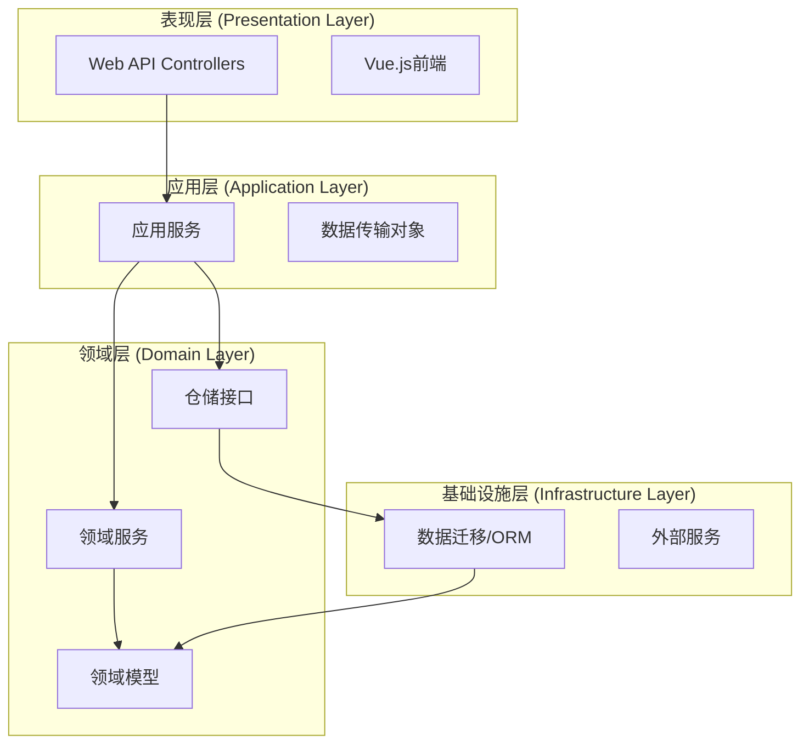
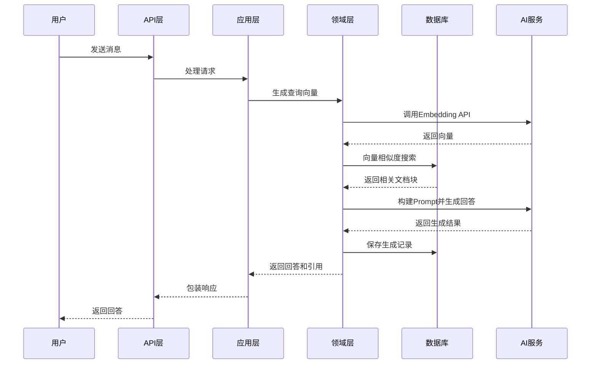

# RAG项目DDD架构设计文档

## 1. 项目概述

### 1.1 项目背景
本项目是一个基于PostgreSQL向量搜索的RAG（检索增强生成）系统，采用领域驱动设计（DDD）架构。系统支持知识库管理、文档处理、向量检索和智能对话等功能。

### 1.2 技术栈
- **后端**: .NET 10.0, ASP.NET Core
- **数据库**: PostgreSQL + pgvector扩展
- **AI框架**: Microsoft Semantic Kernel
- **前端**: Vue.js + TypeScript
- **ORM**: Entity Framework Core

## 2. 架构设计

### 2.1 DDD分层架构



### 2.2 项目引用关系
当前项目结构符合DDD基本规范：

1. **DomainService** (领域层)
   - 包含领域模型和业务逻辑
   - 被Application和DataMigration引用

2. **Application** (应用层)
   - 引用DomainService
   - 包含应用服务和用例协调

3. **DataMigration** (基础设施层)
   - 引用DomainService
   - 包含ORM模型和数据库迁移

4. **PgSqlVectorSearch** (表现层)
   - 引用Application
   - 包含Web API和前端服务


## 3. 领域模型设计

### 3.1 核心领域实体

#### 3.1.1 知识管理领域
- **KnowledgeBase** (知识库): 知识库的聚合根
- **KnowledgeDocument** (知识文档): 文档实体
- **KnowledgeChunk** (知识块): RAG最小处理单元
- **Embedding** (向量嵌入): 文本向量表示

#### 3.1.2 对话管理领域
- **User** (用户): 用户聚合根
- **ChatSession** (聊天会话): 会话实体
- **ChatMessage** (聊天消息): 消息值对象

#### 3.1.3 RAG处理领域
- **RagGeneration** (RAG生成记录)
- **RagRetrievalLog** (检索日志)
- **向量存储基础设施**: 引入`IVectorStore`接口，将向量存储和相似性搜索作为基础设施层服务，遵循依赖倒置原则，`EmbeddingRepository`实现此接口提供pgvector支持

#### 3.1.4 权限与关联关系
- **用户-知识库权限关系**: 通过`UserKnowledgeBase`实体实现多对多关系，支持`OwnerId`、`IsPublic`字段和`AccessLevel`权限级别
- **对话-知识库关联关系**: 一对多关系，`ChatSession`通过`KnowledgeBaseId`关联主要知识库，通过`ReferencedKnowledgeBaseIds`（JSON数组）记录引用的其他知识库
- **文件去重机制**: `KnowledgeDocument`实体新增`FileHash`字段，支持基于哈希值的重复文件检测
- **QueryService架构**: 引入QueryService模式，分离读写职责，Repository负责写操作，QueryService负责复杂查询操作

### 3.2 领域服务接口设计

#### 3.2.1 知识库管理服务
```csharp
public interface IKnowledgeBaseService
{
    Task<KnowledgeBase> CreateKnowledgeBaseAsync(string name, string description);
    Task<KnowledgeBase> GetKnowledgeBaseAsync(Guid id);
    Task<IEnumerable<KnowledgeBase>> ListKnowledgeBasesAsync();
    Task DeleteKnowledgeBaseAsync(Guid id);
}
```

#### 3.2.2 文档处理服务
```csharp
public interface IDocumentProcessingService
{
    Task<KnowledgeDocument> UploadDocumentAsync(Guid knowledgeBaseId, Stream fileStream, string fileName);
    Task ProcessDocumentAsync(Guid documentId);
    Task<IEnumerable<KnowledgeChunk>> GetDocumentChunksAsync(Guid documentId);
}
```

#### 3.2.3 向量检索服务
```csharp
public interface IVectorRetrievalService
{
    Task<IEnumerable<RetrievalResult>> SearchSimilarChunksAsync(string query, int topK = 5);
    Task<Vector> GenerateEmbeddingAsync(string text);
    Task<double> CalculateSimilarityAsync(Vector v1, Vector v2);
}
```

#### 3.2.4 RAG生成服务
```csharp
public interface IRagGenerationService
{
    Task<RagResponse> GenerateResponseAsync(string query, Guid? sessionId = null);
    Task<RagResponse> GenerateResponseWithContextAsync(string query, IEnumerable<KnowledgeChunk> context);
    Task LogRetrievalAsync(Guid generationId, IEnumerable<RetrievalLog> logs);
}
```

#### 3.2.5 对话管理服务
```csharp
public interface IChatService
{
    Task<ChatSession> CreateSessionAsync(Guid userId, string title);
    Task<ChatMessage> AddMessageAsync(Guid sessionId, string content, ChatRole role);
    Task<IEnumerable<ChatSession>> GetUserSessionsAsync(Guid userId);
    Task<IEnumerable<ChatMessage>> GetSessionMessagesAsync(Guid sessionId);
}
```

#### 3.2.6 其他领域服务接口

以下是为完善系统功能而设计的额外领域服务接口：

##### 3.2.6.1 认证授权服务
```csharp
public interface IAuthService
{
    Task<User> AuthenticateAsync(string username, string password);
    Task<User> RegisterAsync(string username, string email, string password);
    Task<bool> ValidateTokenAsync(string token);
    Task ChangePasswordAsync(int userId, string oldPassword, string newPassword);
}
```

##### 3.2.6.2 文件存储服务
```csharp
public interface IFileStorageService
{
    Task<string> UploadFileAsync(Stream fileStream, string fileName, string contentType);
    Task<Stream> DownloadFileAsync(string fileId);
    Task DeleteFileAsync(string fileId);
}
```

##### 3.2.6.3 任务队列服务
```csharp
public interface ITaskQueueService
{
    Task<string> EnqueueDocumentProcessingAsync(Guid documentId);
    Task<string> EnqueueVectorGenerationAsync(Guid chunkId);
    Task<TaskStatus> GetTaskStatusAsync(string taskId);
}
```

##### 3.2.6.4 缓存服务
```csharp
public interface ICacheService
{
    Task<T?> GetAsync<T>(string key);
    Task SetAsync<T>(string key, T value, TimeSpan expiration);
    Task RemoveAsync(string key);
}
```

##### 3.2.6.5 审计日志服务
```csharp
public interface IAuditLogService
{
    Task LogOperationAsync(string operation, int? userId, object details);
    Task<IEnumerable<AuditLog>> QueryLogsAsync(DateTime start, DateTime end, string? operation);
}
```

##### 3.2.6.6 向量存储服务
```csharp
public interface IVectorStore
{
    /// <summary>
    /// 根据知识块ID获取嵌入向量
    /// </summary>
    Task<Embedding?> GetByChunkIdAsync(Guid chunkId);

    /// <summary>
    /// 搜索相似的嵌入向量
    /// </summary>
    Task<IEnumerable<Embedding>> SearchSimilarAsync(Vector queryVector, int limit, DistanceMetric metric = DistanceMetric.L2);

    /// <summary>
    /// 添加嵌入向量
    /// </summary>
    Task AddAsync(Embedding embedding);

    /// <summary>
    /// 批量添加嵌入向量
    /// </summary>
    Task AddRangeAsync(IEnumerable<Embedding> embeddings);

    /// <summary>
    /// 根据知识块ID删除嵌入向量
    /// </summary>
    Task DeleteByChunkIdAsync(Guid chunkId);

    /// <summary>
    /// 带过滤条件的向量相似度搜索
    /// </summary>
    Task<IEnumerable<Embedding>> SearchSimilarWithFilterAsync(
        Vector queryVector,
        int limit,
        DistanceMetric metric = DistanceMetric.L2,
        Guid? knowledgeBaseId = null,
        Guid? documentId = null);
}
```

## 4. 应用服务设计

### 4.1 应用服务接口

#### 4.1.1 知识库应用服务
```csharp
public interface IKnowledgeBaseAppService
{
    Task<KnowledgeBaseDto> CreateKnowledgeBaseAsync(CreateKnowledgeBaseRequest request);
    Task<KnowledgeBaseDto> GetKnowledgeBaseAsync(Guid id);
    Task<PagedResult<KnowledgeBaseDto>> ListKnowledgeBasesAsync(int page, int pageSize);
    Task UploadDocumentAsync(Guid knowledgeBaseId, UploadDocumentRequest request);
    Task ProcessKnowledgeBaseAsync(Guid knowledgeBaseId);
}
```

#### 4.1.2 RAG对话应用服务
```csharp
public interface IRagChatAppService
{
    Task<ChatSessionDto> CreateChatSessionAsync(Guid userId, string title);
    Task<ChatResponseDto> SendMessageAsync(Guid sessionId, SendMessageRequest request);
    Task<IEnumerable<ChatSessionDto>> GetUserChatSessionsAsync(Guid userId);
    Task<ChatHistoryDto> GetChatHistoryAsync(Guid sessionId);
}
```

#### 4.1.3 文档管理应用服务
```csharp
public interface IDocumentManagementAppService
{
    Task<DocumentDto> UploadDocumentAsync(Guid knowledgeBaseId, IFormFile file);
    Task<IEnumerable<DocumentDto>> GetDocumentsAsync(Guid knowledgeBaseId);
    Task DeleteDocumentAsync(Guid documentId);
    Task ReprocessDocumentAsync(Guid documentId);
}
```

#### 4.1.4 其他应用服务接口

以下是为完善系统功能而设计的额外应用服务接口：

##### 4.1.4.1 系统管理服务
```csharp
public interface ISystemAdminAppService
{
    Task<SystemStatusDto> GetSystemStatusAsync();
    Task<SystemMetricsDto> GetSystemMetricsAsync(TimeRange range);
    Task CleanupOldDataAsync(DateTime cutoffDate);
}
```

##### 4.1.4.2 统计分析服务
```csharp
public interface IAnalyticsAppService
{
    Task<UsageStatisticsDto> GetUsageStatisticsAsync(DateOnly start, DateOnly end);
    Task<KnowledgeBaseUsageDto> GetKnowledgeBaseUsageAsync(Guid knowledgeBaseId);
    Task<PopularQueriesDto> GetPopularQueriesAsync(int topN);
}
```

##### 4.1.4.3 批量操作服务
```csharp
public interface IBatchOperationAppService
{
    Task<BatchImportResultDto> ImportDocumentsAsync(Guid knowledgeBaseId, IFormFile zipFile);
    Task<BatchProcessResultDto> ReprocessKnowledgeBaseAsync(Guid knowledgeBaseId);
}
```

### 4.2 数据传输对象(DTO)

#### 4.2.1 请求DTO
```csharp
public class CreateKnowledgeBaseRequest
{
    public string Name { get; set; }
    public string Description { get; set; }
}

public class UploadDocumentRequest
{
    public IFormFile File { get; set; }
    public string FileName { get; set; }
}

public class SendMessageRequest
{
    public string Message { get; set; }
    public Guid? KnowledgeBaseId { get; set; }
}
```

#### 4.2.2 响应DTO
```csharp
public class KnowledgeBaseDto
{
    public Guid Id { get; set; }
    public string Name { get; set; }
    public string Description { get; set; }
    public DateTime CreatedAt { get; set; }
    public int DocumentCount { get; set; }
}

public class ChatResponseDto
{
    public string Answer { get; set; }
    public IEnumerable<RetrievedChunkDto> RetrievedChunks { get; set; }
    public Guid SessionId { get; set; }
    public DateTime GeneratedAt { get; set; }
}

public class RetrievedChunkDto
{
    public string Content { get; set; }
    public string SourceDocument { get; set; }
    public double SimilarityScore { get; set; }
}
```

## 5. API接口设计

### 5.1 RESTful API端点

#### 5.1.1 知识库管理API
```
GET    /api/knowledge-bases                    # 获取知识库列表
POST   /api/knowledge-bases                    # 创建知识库
GET    /api/knowledge-bases/{id}               # 获取知识库详情
PUT    /api/knowledge-bases/{id}               # 更新知识库
DELETE /api/knowledge-bases/{id}               # 删除知识库
POST   /api/knowledge-bases/{id}/documents     # 上传文档
POST   /api/knowledge-bases/{id}/process       # 处理知识库
```

#### 5.1.2 文档管理API
```
GET    /api/documents                          # 获取文档列表
GET    /api/documents/{id}                     # 获取文档详情
DELETE /api/documents/{id}                     # 删除文档
POST   /api/documents/{id}/reprocess           # 重新处理文档
GET    /api/documents/{id}/chunks              # 获取文档分块
```

#### 5.1.3 对话API
```
GET    /api/chat/conversations                 # 获取会话列表（对应前端）
POST   /api/chat/conversations                 # 创建会话（对应前端）
GET    /api/chat/conversations/{id}            # 获取会话详情
DELETE /api/chat/conversations/{id}            # 删除会话（对应前端）
GET    /api/chat/conversations/{id}/messages   # 获取会话消息（对应前端）
POST   /api/chat/messages                      # 发送消息（对应前端，需包含conversationId）
POST   /api/chat/rag                           # RAG对话（无会话，直接检索生成）
```

#### 5.1.4 认证授权API
```
POST   /api/auth/login                         # 用户登录
POST   /api/auth/logout                        # 用户登出
GET    /api/auth/user                          # 获取当前用户信息
POST   /api/auth/register                      # 用户注册
PUT    /api/auth/password                      # 修改密码
```

#### 5.1.5 用户管理API
```
GET    /api/users/{id}                         # 获取用户信息
PUT    /api/users/{id}/profile                 # 更新用户资料
GET    /api/users/{id}/sessions                # 获取用户会话列表
```

#### 5.1.6 系统管理API
```
GET    /api/admin/health                       # 健康检查
GET    /api/admin/metrics                      # 系统指标
GET    /api/admin/logs                         # 审计日志查询
POST   /api/admin/cleanup                      # 数据清理
```

#### 5.1.7 统计分析API
```
GET    /api/analytics/usage                    # 使用统计
GET    /api/analytics/knowledge-bases/{id}/usage  # 知识库使用情况
GET    /api/analytics/queries                  # 热门查询
```

### 5.2 Web API控制器示例

```csharp
[ApiController]
[Route("api/knowledge-bases")]
public class KnowledgeBaseController : ControllerBase
{
    private readonly IKnowledgeBaseAppService _knowledgeBaseAppService;
    
    public KnowledgeBaseController(IKnowledgeBaseAppService knowledgeBaseAppService)
    {
        _knowledgeBaseAppService = knowledgeBaseAppService;
    }
    
    [HttpGet]
    public async Task<ActionResult<PagedResult<KnowledgeBaseDto>>> GetKnowledgeBases(
        [FromQuery] int page = 1, 
        [FromQuery] int pageSize = 20)
    {
        var result = await _knowledgeBaseAppService.ListKnowledgeBasesAsync(page, pageSize);
        return Ok(result);
    }
    
    [HttpPost]
    public async Task<ActionResult<KnowledgeBaseDto>> CreateKnowledgeBase(
        [FromBody] CreateKnowledgeBaseRequest request)
    {
        var result = await _knowledgeBaseAppService.CreateKnowledgeBaseAsync(request);
        return CreatedAtAction(nameof(GetKnowledgeBase), new { id = result.Id }, result);
    }
    
    [HttpPost("{id}/documents")]
    public async Task<ActionResult> UploadDocument(
        Guid id, 
        [FromForm] UploadDocumentRequest request)
    {
        await _knowledgeBaseAppService.UploadDocumentAsync(id, request);
        return Accepted();
    }
}
```

## 6. 实现指南

### 6.1 项目结构优化建议

#### 6.1.1 当前结构进展
**✅ 已完成的核心架构**
1. **领域服务接口与实现**：核心领域服务已基本实现（RagGenerationService、ChatService、KnowledgeBaseService、DocumentProcessingService、VectorRetrievalService、AuthService等）
2. **用户权限与关联关系**：用户-知识库权限关系（UserKnowledgeBase）、对话-知识库关联关系、文件去重机制已实现
3. **QueryService架构**：完整实现CQRS模式，Repository负责写操作，QueryService负责复杂查询
4. **Semantic Kernel AI集成**：AI服务基础设施已完成（OpenAILLMService、OpenAIEmbeddingService、PromptTemplateService）
5. **应用服务与API**：应用服务层基本实现，API控制器框架就绪
6. **仓储接口重构与向量存储**：遵循DDD聚合根原则，移除非聚合根仓储接口（IEmbeddingRepository、IChatMessageRepository、IKnowledgeChunkRepository），引入IVectorStore基础设施服务，将向量存储职责分离为独立服务

**⚠️ 待解决的结构问题**
1. **依赖注入配置**：`Program.cs`中服务注册已部分完成（已注册IVectorStore、IEmbeddingService等），但仍需注册所有领域服务、应用服务和仓储接口
2. **服务集成**：AI服务与领域服务尚未完全集成，RAG核心流程需要连接测试
3. **配置管理**：数据库连接字符串硬编码，需要迁移到配置文件
4. **权限集成**：权限验证逻辑需要集成到服务层和API层
5. **前端对接**：需要配置CORS和API客户端，确保前后端通信
6. **仓储接口一致性**：需要确保所有仓储接口只对应聚合根，移除非聚合根仓储的使用

#### 6.1.2 下一步实施建议
1. **完善依赖注入配置（优先级：高）**
   - 更新`Program.cs`，注册所有领域服务、应用服务、QueryService和AI服务
   - 配置数据库上下文，使用配置文件管理连接字符串
   - 添加授权中间件和CORS配置

2. **集成RAG核心流程（优先级：高）**
   - 连接`RagGenerationService`与`OpenAIEmbeddingService`、`OpenAILLMService`
   - 测试向量检索和生成完整流程
   - 实现`PromptTemplateService`的模板管理

3. **完善权限管理（优先级：中）**
   - 在服务层集成`UserKnowledgeBaseService`权限验证
   - 在API控制器添加授权属性
   - 实现公共知识库访问逻辑

4. **前端对接配置（优先级：中）**
   - 配置CORS允许前端开发服务器（端口5173）
   - 更新前端API客户端，连接实际后端端点
   - 验证用户认证流程

5. **数据库优化（优先级：低）**
   - 为向量列创建IVFFlat索引提升查询性能
   - 实现连接池配置
   - 添加数据库健康检查

### 6.2 依赖注入配置

```csharp
// Program.cs 中的服务注册（更新版，反映仓储重构和向量存储引入）
public static void ConfigureServices(IServiceCollection services, IConfiguration configuration)
{
    // 1. 数据库上下文配置（使用appsettings.json配置）
    services.AddDbContext<RagDbContext>(options =>
        options.UseNpgsql(configuration.GetConnectionString("DefaultConnection")));

    // 2. QueryService注册（CQRS查询服务）
    services.AddScoped(typeof(IQueryService<>), typeof(QueryServiceBase<>));
    services.AddScoped<IVectorSearchQueryService, VectorSearchQueryService>();
    // 注意：IKnowledgeBaseQueryService和IKnowledgeChunkQueryService的实现可能在其他项目中

    // 3. 仓储接口注册（只对应聚合根）
    services.AddScoped(typeof(IRepository<>), typeof(RepositoryBase<>));
    services.AddScoped<IKnowledgeBaseRepository, KnowledgeBaseRepository>();
    services.AddScoped<IKnowledgeDocumentRepository, KnowledgeDocumentRepository>();
    // 注意：IKnowledgeChunkRepository、IEmbeddingRepository、IChatMessageRepository已被移除
    // 这些非聚合根实体应通过聚合根或专用服务访问
    services.AddScoped<IChatSessionRepository, ChatSessionRepository>();
    services.AddScoped<IUserRepository, UserRepository>();
    services.AddScoped<IUserKnowledgeBaseRepository, UserKnowledgeBaseRepository>();
    services.AddScoped<IRagGenerationRepository, RagGenerationRepository>();

    // 4. 向量存储基础设施服务（替代IEmbeddingRepository）
    services.AddScoped<IVectorStore, EmbeddingRepository>();

    // 5. AI服务注册
    services.AddScoped<IEmbeddingService, OpenAIEmbeddingService>();
    services.AddScoped<ILLMService, OpenAILLMService>();
    services.AddScoped<ISemanticKernelService, SemanticKernelService>();
    services.AddScoped<IPromptTemplateService, PromptTemplateService>();

    // 6. 领域服务注册
    services.AddScoped<IKnowledgeBaseService, KnowledgeBaseService>();
    services.AddScoped<IDocumentProcessingService, DocumentProcessingService>();
    services.AddScoped<IVectorRetrievalService, VectorRetrievalService>();
    services.AddScoped<IRagGenerationService, RagGenerationService>();
    services.AddScoped<IChatService, ChatService>();
    services.AddScoped<IAuthService, AuthService>();
    services.AddScoped<IUserKnowledgeBaseService, UserKnowledgeBaseService>();

    // 7. 应用服务注册
    services.AddScoped<IKnowledgeBaseAppService, KnowledgeBaseAppService>();
    services.AddScoped<IRagChatAppService, RagChatAppService>();
    services.AddScoped<IDocumentManagementAppService, DocumentManagementAppService>();
    services.AddScoped<ISystemAdminAppService, SystemAdminAppService>();
    services.AddScoped<IAnalyticsAppService, AnalyticsAppService>();
    services.AddScoped<IBatchOperationAppService, BatchOperationAppService>();
    services.AddScoped<IAuthAppService, AuthAppService>();
    services.AddScoped<IUserAppService, UserAppService>();

    // 8. 控制器自动注册
    services.AddControllers();

    // 9. CORS配置（前端开发服务器端口5173）
    services.AddCors(options =>
    {
        options.AddPolicy("FrontendDev",
            builder => builder
                .WithOrigins("http://localhost:5173")
                .AllowAnyMethod()
                .AllowAnyHeader()
                .AllowCredentials());
    });

    // 10. 授权认证配置
    services.AddAuthorization();

    // 11. Swagger/OpenAPI文档
    services.AddOpenApi();
}
```

### 6.3 数据库迁移策略

1. **初始迁移已存在**
   - 当前已有20260302093034_InitialCreate迁移
   - 包含所有表结构和向量扩展

2. **领域模型变更处理**
   - 修改DomainService中的实体
   - 在DataMigration中创建新的迁移
   - 应用迁移到数据库

### 6.4 RAG处理流程




## 7. 总结与后续规划

### 7.1 当前状态评估（2026-03-09更新）

#### ✅ 已完成的核心架构
1. **DDD分层结构完整**
   - 领域层 (DomainService)：包含完整领域实体和接口定义
   - 应用层 (Application)：应用服务接口和实现基本完成
   - 基础设施层 (Infrastructure)：仓储实现、QueryService、AI服务集成
   - 表现层 (PgSqlVectorSearch)：API控制器基本实现

2. **领域模型完善**
   - 核心实体：KnowledgeBase、KnowledgeDocument、KnowledgeChunk、Embedding、User、ChatSession、ChatMessage、RagGeneration等
   - 权限关系：User-KnowledgeBase多对多关系，支持OwnerId、IsPublic、AccessLevel
   - 关联关系：ChatSession-KnowledgeBase关联，ReferencedKnowledgeBaseIds JSON字段
   - 文件去重：KnowledgeDocument.FileHash支持重复文件检测

3. **仓储模式与QueryService架构**
   - **Repository模式**：完整实现`IRepository<T>`接口，支持CRUD、批量操作、条件查询
   - **仓储接口重构**：遵循DDD聚合根原则，移除非聚合根仓储接口（`IEmbeddingRepository`、`IChatMessageRepository`、`IKnowledgeChunkRepository`），引入`IVectorStore`基础设施服务处理向量存储和相似性搜索
   - **QueryService架构**：引入CQRS原则，分离读写职责
     - Repository：负责写操作和基本查询
     - QueryService：负责复杂查询（包含导航属性、排序、分页、投影等）
   - 已实现`IQueryService<T>`、`IKnowledgeBaseQueryService`、`IKnowledgeChunkQueryService`、`IVectorSearchQueryService`（替代`IEmbeddingQueryService`）

4. **服务层实现**
   - **领域服务**：大部分已实现
     - `RagGenerationService`、`ChatService`、`KnowledgeBaseService`、`DocumentProcessingService`
     - `VectorRetrievalService`、`AuthService`、`UserKnowledgeBaseService`等
   - **应用服务**：主要接口已实现
     - `RagChatAppService`、`KnowledgeBaseAppService`、`DocumentManagementAppService`
     - `AuthAppService`、`UserAppService`、`SystemAdminAppService`等
   - **AI服务集成**：Semantic Kernel基础设施完成
     - `ISemanticKernelService`接口定义
     - `OpenAILLMService`、`OpenAIEmbeddingService`实现
     - `PromptTemplateService`支持模板管理

5. **API层实现**
   - RESTful API控制器基本完成：`KnowledgeBaseController`、`ChatController`、`DocumentController`、`AuthController`等
   - API端点符合设计文档规范
   - DTO数据传输对象定义完整

#### ⚠️ 待完善/待集成部分
1. **依赖注入配置**
   - `Program.cs`中服务注册已部分完成（已注册IVectorStore、IEmbeddingService等），但仍需注册所有领域服务、应用服务和仓储接口
   - 数据库连接字符串目前硬编码，需要迁移到配置系统

2. **RAG核心流程集成**
   - AI服务（Semantic Kernel）已实现，但尚未与领域服务完全集成
   - `RagGenerationService`需要连接`OpenAIEmbeddingService`和`OpenAILLMService`
   - 向量检索流程需要完整测试

3. **权限管理逻辑**
   - `UserKnowledgeBaseService`已实现，但权限验证逻辑需要集成到各服务
   - API层需要添加授权中间件

4. **功能完整性**
   - 部分控制器方法未完全实现（如更新、删除操作）
   - 批量操作、统计分析等功能待测试验证

5. **数据库配置**
   - 目前使用硬编码连接字符串，需要改为配置驱动
   - 向量索引优化（IVFFlat）尚未实施

6. **前端集成**
   - 前端项目（fronted/）存在，但需要与后端API完全对接
   - 需要配置CORS和API客户端

7. **仓储接口一致性**
   - 需要确保所有仓储接口只对应聚合根，移除非聚合根仓储的使用
   - 更新服务层代码，使用聚合根仓储或专用服务访问非聚合根实体

### 7.2 后续开发任务（基于当前状态）

#### 阶段一：系统集成与配置（1-2周）
**目标**：使系统可运行，完成核心流程集成

1. **依赖注入与配置完善**
   - 更新`Program.cs`实现完整的服务注册（参考6.2节）
   - 将数据库连接字符串迁移到`appsettings.json`配置文件
   - 配置CORS支持前端开发服务器（端口5173）

2. **RAG核心流程集成**
   - 连接`RagGenerationService`与AI服务（`OpenAIEmbeddingService`、`OpenAILLMService`）
   - 测试向量检索、生成完整流程
   - 验证`PromptTemplateService`模板功能

3. **权限管理集成**
   - 在服务层集成`UserKnowledgeBaseService`权限验证
   - 在API控制器添加授权属性
   - 测试公共/私有知识库访问控制

#### 阶段二：功能完善与测试（2-3周）
**目标**：完善系统功能，确保核心业务流程可用

1. **API功能完善**
   - 补全控制器缺失方法（更新、删除操作）
   - 实现批量操作接口测试
   - 完善错误处理和验证逻辑

2. **前端对接**
   - 配置前端API客户端连接实际后端
   - 验证用户认证、知识库管理、对话等核心功能
   - 测试文件上传和文档处理流程

3. **数据库优化**
   - 为向量列创建IVFFlat索引提升查询性能
   - 实现连接池配置
   - 添加数据库健康检查端点

#### 阶段三：性能优化与监控（3-4周）
**目标**：提升系统性能，增加可观测性

1. **缓存策略实施**
   - 实现热门查询结果缓存
   - 添加向量缓存减少AI API调用
   - 文档元数据缓存优化

2. **异步处理优化**
   - 文档处理后台任务队列
   - 批量向量生成优化
   - 异步日志记录系统

3. **监控与可观测性**
   - 添加系统健康检查端点
   - 实现请求/响应日志中间件
   - 集成应用性能监控（APM）工具

### 7.3 性能优化建议
1. **数据库优化**
   - 为向量列创建IVFFlat索引
   - 定期清理过期数据
   - 使用连接池管理

2. **缓存策略**
   - 热门查询结果缓存
   - 向量缓存减少AI调用
   - 文档元数据缓存

3. **异步处理**
   - 文档处理使用后台任务
   - 批量向量生成
   - 异步日志记录

---

**文档版本**: 1.3
**最后更新**: 2026-03-09
**作者**: 架构设计团队
**状态**: 已更新，反映当前项目状态（包含仓储接口重构和向量存储引入）