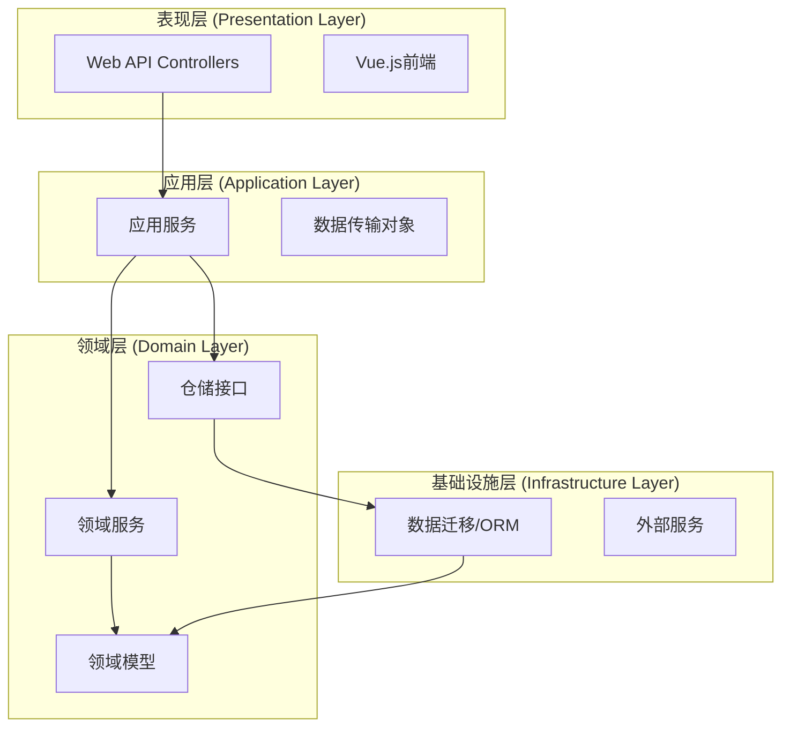
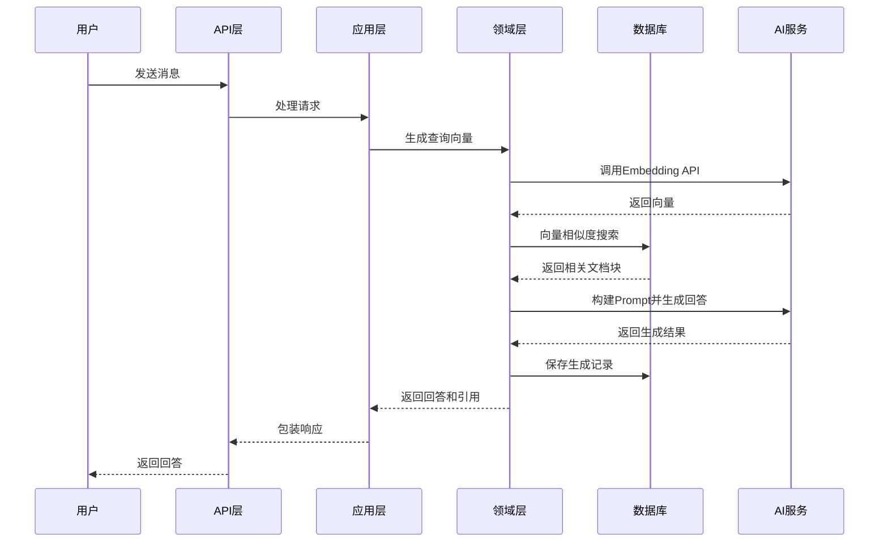

# RAG项目DDD架构设计文档

## 1. 项目概述

### 1.1 项目背景
本项目是一个基于PostgreSQL向量搜索的RAG（检索增强生成）系统，采用领域驱动设计（DDD）架构。系统支持知识库管理、文档处理、向量检索和智能对话等功能。

### 1.2 技术栈
- **后端**: .NET 10.0, ASP.NET Core
- **数据库**: PostgreSQL + pgvector扩展
- **AI框架**: Microsoft Semantic Kernel
- **前端**: Vue.js + TypeScript
- **ORM**: Entity Framework Core

## 2. 架构设计

### 2.1 DDD分层架构



### 2.2 项目引用关系
当前项目结构符合DDD基本规范：

1. **DomainService** (领域层)
   - 包含领域模型和业务逻辑
   - 被Application和DataMigration引用

2. **Application** (应用层)
   - 引用DomainService
   - 包含应用服务和用例协调

3. **DataMigration** (基础设施层)
   - 引用DomainService
   - 包含ORM模型和数据库迁移

4. **PgSqlVectorSearch** (表现层)
   - 引用Application
   - 包含Web API和前端服务


## 3. 领域模型设计

### 3.1 核心领域实体

#### 3.1.1 知识管理领域
- **KnowledgeBase** (知识库): 知识库的聚合根
- **KnowledgeDocument** (知识文档): 文档实体
- **KnowledgeChunk** (知识块): RAG最小处理单元
- **Embedding** (向量嵌入): 文本向量表示

#### 3.1.2 对话管理领域
- **User** (用户): 用户聚合根
- **ChatSession** (聊天会话): 会话实体
- **ChatMessage** (聊天消息): 消息值对象

#### 3.1.3 RAG处理领域
- **RagGeneration** (RAG生成记录)
- **RagRetrievalLog** (检索日志)

### 3.2 领域服务接口设计

#### 3.2.1 知识库管理服务
```csharp
public interface IKnowledgeBaseService
{
    Task<KnowledgeBase> CreateKnowledgeBaseAsync(string name, string description);
    Task<KnowledgeBase> GetKnowledgeBaseAsync(Guid id);
    Task<IEnumerable<KnowledgeBase>> ListKnowledgeBasesAsync();
    Task DeleteKnowledgeBaseAsync(Guid id);
}
```

#### 3.2.2 文档处理服务
```csharp
public interface IDocumentProcessingService
{
    Task<KnowledgeDocument> UploadDocumentAsync(Guid knowledgeBaseId, Stream fileStream, string fileName);
    Task ProcessDocumentAsync(Guid documentId);
    Task<IEnumerable<KnowledgeChunk>> GetDocumentChunksAsync(Guid documentId);
}
```

#### 3.2.3 向量检索服务
```csharp
public interface IVectorRetrievalService
{
    Task<IEnumerable<RetrievalResult>> SearchSimilarChunksAsync(string query, int topK = 5);
    Task<Vector> GenerateEmbeddingAsync(string text);
    Task<double> CalculateSimilarityAsync(Vector v1, Vector v2);
}
```

#### 3.2.4 RAG生成服务
```csharp
public interface IRagGenerationService
{
    Task<RagResponse> GenerateResponseAsync(string query, Guid? sessionId = null);
    Task<RagResponse> GenerateResponseWithContextAsync(string query, IEnumerable<KnowledgeChunk> context);
    Task LogRetrievalAsync(Guid generationId, IEnumerable<RetrievalLog> logs);
}
```

#### 3.2.5 对话管理服务
```csharp
public interface IChatService
{
    Task<ChatSession> CreateSessionAsync(Guid userId, string title);
    Task<ChatMessage> AddMessageAsync(Guid sessionId, string content, ChatRole role);
    Task<IEnumerable<ChatSession>> GetUserSessionsAsync(Guid userId);
    Task<IEnumerable<ChatMessage>> GetSessionMessagesAsync(Guid sessionId);
}
```

#### 3.2.6 其他领域服务接口

以下是为完善系统功能而设计的额外领域服务接口：

##### 3.2.6.1 认证授权服务
```csharp
public interface IAuthService
{
    Task<User> AuthenticateAsync(string username, string password);
    Task<User> RegisterAsync(string username, string email, string password);
    Task<bool> ValidateTokenAsync(string token);
    Task ChangePasswordAsync(int userId, string oldPassword, string newPassword);
}
```

##### 3.2.6.2 文件存储服务
```csharp
public interface IFileStorageService
{
    Task<string> UploadFileAsync(Stream fileStream, string fileName, string contentType);
    Task<Stream> DownloadFileAsync(string fileId);
    Task DeleteFileAsync(string fileId);
}
```

##### 3.2.6.3 任务队列服务
```csharp
public interface ITaskQueueService
{
    Task<string> EnqueueDocumentProcessingAsync(Guid documentId);
    Task<string> EnqueueVectorGenerationAsync(Guid chunkId);
    Task<TaskStatus> GetTaskStatusAsync(string taskId);
}
```

##### 3.2.6.4 缓存服务
```csharp
public interface ICacheService
{
    Task<T?> GetAsync<T>(string key);
    Task SetAsync<T>(string key, T value, TimeSpan expiration);
    Task RemoveAsync(string key);
}
```

##### 3.2.6.5 审计日志服务
```csharp
public interface IAuditLogService
{
    Task LogOperationAsync(string operation, int? userId, object details);
    Task<IEnumerable<AuditLog>> QueryLogsAsync(DateTime start, DateTime end, string? operation);
}
```

## 4. 应用服务设计

### 4.1 应用服务接口

#### 4.1.1 知识库应用服务
```csharp
public interface IKnowledgeBaseAppService
{
    Task<KnowledgeBaseDto> CreateKnowledgeBaseAsync(CreateKnowledgeBaseRequest request);
    Task<KnowledgeBaseDto> GetKnowledgeBaseAsync(Guid id);
    Task<PagedResult<KnowledgeBaseDto>> ListKnowledgeBasesAsync(int page, int pageSize);
    Task UploadDocumentAsync(Guid knowledgeBaseId, UploadDocumentRequest request);
    Task ProcessKnowledgeBaseAsync(Guid knowledgeBaseId);
}
```

#### 4.1.2 RAG对话应用服务
```csharp
public interface IRagChatAppService
{
    Task<ChatSessionDto> CreateChatSessionAsync(Guid userId, string title);
    Task<ChatResponseDto> SendMessageAsync(Guid sessionId, SendMessageRequest request);
    Task<IEnumerable<ChatSessionDto>> GetUserChatSessionsAsync(Guid userId);
    Task<ChatHistoryDto> GetChatHistoryAsync(Guid sessionId);
}
```

#### 4.1.3 文档管理应用服务
```csharp
public interface IDocumentManagementAppService
{
    Task<DocumentDto> UploadDocumentAsync(Guid knowledgeBaseId, IFormFile file);
    Task<IEnumerable<DocumentDto>> GetDocumentsAsync(Guid knowledgeBaseId);
    Task DeleteDocumentAsync(Guid documentId);
    Task ReprocessDocumentAsync(Guid documentId);
}
```

#### 4.1.4 其他应用服务接口

以下是为完善系统功能而设计的额外应用服务接口：

##### 4.1.4.1 系统管理服务
```csharp
public interface ISystemAdminAppService
{
    Task<SystemStatusDto> GetSystemStatusAsync();
    Task<SystemMetricsDto> GetSystemMetricsAsync(TimeRange range);
    Task CleanupOldDataAsync(DateTime cutoffDate);
}
```

##### 4.1.4.2 统计分析服务
```csharp
public interface IAnalyticsAppService
{
    Task<UsageStatisticsDto> GetUsageStatisticsAsync(DateOnly start, DateOnly end);
    Task<KnowledgeBaseUsageDto> GetKnowledgeBaseUsageAsync(Guid knowledgeBaseId);
    Task<PopularQueriesDto> GetPopularQueriesAsync(int topN);
}
```

##### 4.1.4.3 批量操作服务
```csharp
public interface IBatchOperationAppService
{
    Task<BatchImportResultDto> ImportDocumentsAsync(Guid knowledgeBaseId, IFormFile zipFile);
    Task<BatchProcessResultDto> ReprocessKnowledgeBaseAsync(Guid knowledgeBaseId);
}
```

### 4.2 数据传输对象(DTO)

#### 4.2.1 请求DTO
```csharp
public class CreateKnowledgeBaseRequest
{
    public string Name { get; set; }
    public string Description { get; set; }
}

public class UploadDocumentRequest
{
    public IFormFile File { get; set; }
    public string FileName { get; set; }
}

public class SendMessageRequest
{
    public string Message { get; set; }
    public Guid? KnowledgeBaseId { get; set; }
}
```

#### 4.2.2 响应DTO
```csharp
public class KnowledgeBaseDto
{
    public Guid Id { get; set; }
    public string Name { get; set; }
    public string Description { get; set; }
    public DateTime CreatedAt { get; set; }
    public int DocumentCount { get; set; }
}

public class ChatResponseDto
{
    public string Answer { get; set; }
    public IEnumerable<RetrievedChunkDto> RetrievedChunks { get; set; }
    public Guid SessionId { get; set; }
    public DateTime GeneratedAt { get; set; }
}

public class RetrievedChunkDto
{
    public string Content { get; set; }
    public string SourceDocument { get; set; }
    public double SimilarityScore { get; set; }
}
```

## 5. API接口设计

### 5.1 RESTful API端点

#### 5.1.1 知识库管理API
```
GET    /api/knowledge-bases                    # 获取知识库列表
POST   /api/knowledge-bases                    # 创建知识库
GET    /api/knowledge-bases/{id}               # 获取知识库详情
PUT    /api/knowledge-bases/{id}               # 更新知识库
DELETE /api/knowledge-bases/{id}               # 删除知识库
POST   /api/knowledge-bases/{id}/documents     # 上传文档
POST   /api/knowledge-bases/{id}/process       # 处理知识库
```

#### 5.1.2 文档管理API
```
GET    /api/documents                          # 获取文档列表
GET    /api/documents/{id}                     # 获取文档详情
DELETE /api/documents/{id}                     # 删除文档
POST   /api/documents/{id}/reprocess           # 重新处理文档
GET    /api/documents/{id}/chunks              # 获取文档分块
```

#### 5.1.3 对话API
```
GET    /api/chat/conversations                 # 获取会话列表（对应前端）
POST   /api/chat/conversations                 # 创建会话（对应前端）
GET    /api/chat/conversations/{id}            # 获取会话详情
DELETE /api/chat/conversations/{id}            # 删除会话（对应前端）
GET    /api/chat/conversations/{id}/messages   # 获取会话消息（对应前端）
POST   /api/chat/messages                      # 发送消息（对应前端，需包含conversationId）
POST   /api/chat/rag                           # RAG对话（无会话，直接检索生成）
```

#### 5.1.4 认证授权API
```
POST   /api/auth/login                         # 用户登录
POST   /api/auth/logout                        # 用户登出
GET    /api/auth/user                          # 获取当前用户信息
POST   /api/auth/register                      # 用户注册
PUT    /api/auth/password                      # 修改密码
```

#### 5.1.5 用户管理API
```
GET    /api/users/{id}                         # 获取用户信息
PUT    /api/users/{id}/profile                 # 更新用户资料
GET    /api/users/{id}/sessions                # 获取用户会话列表
```

#### 5.1.6 系统管理API
```
GET    /api/admin/health                       # 健康检查
GET    /api/admin/metrics                      # 系统指标
GET    /api/admin/logs                         # 审计日志查询
POST   /api/admin/cleanup                      # 数据清理
```

#### 5.1.7 统计分析API
```
GET    /api/analytics/usage                    # 使用统计
GET    /api/analytics/knowledge-bases/{id}/usage  # 知识库使用情况
GET    /api/analytics/queries                  # 热门查询
```

### 5.2 Web API控制器示例

```csharp
[ApiController]
[Route("api/knowledge-bases")]
public class KnowledgeBaseController : ControllerBase
{
    private readonly IKnowledgeBaseAppService _knowledgeBaseAppService;
    
    public KnowledgeBaseController(IKnowledgeBaseAppService knowledgeBaseAppService)
    {
        _knowledgeBaseAppService = knowledgeBaseAppService;
    }
    
    [HttpGet]
    public async Task<ActionResult<PagedResult<KnowledgeBaseDto>>> GetKnowledgeBases(
        [FromQuery] int page = 1, 
        [FromQuery] int pageSize = 20)
    {
        var result = await _knowledgeBaseAppService.ListKnowledgeBasesAsync(page, pageSize);
        return Ok(result);
    }
    
    [HttpPost]
    public async Task<ActionResult<KnowledgeBaseDto>> CreateKnowledgeBase(
        [FromBody] CreateKnowledgeBaseRequest request)
    {
        var result = await _knowledgeBaseAppService.CreateKnowledgeBaseAsync(request);
        return CreatedAtAction(nameof(GetKnowledgeBase), new { id = result.Id }, result);
    }
    
    [HttpPost("{id}/documents")]
    public async Task<ActionResult> UploadDocument(
        Guid id, 
        [FromForm] UploadDocumentRequest request)
    {
        await _knowledgeBaseAppService.UploadDocumentAsync(id, request);
        return Accepted();
    }
}
```

## 6. 实现指南

### 6.1 项目结构优化建议

#### 6.1.1 当前结构问题
- 服务接口未实际实现

#### 6.1.2 重构建议
1. **领域模型已就位（已完成）**
   - 领域实体已在DomainService/Entities中定义
   - DataMigration正确引用领域实体

2. **实现服务接口**
   - 在DomainService/Service中实现领域服务
   - 在Application/ApplicationService中实现应用服务
   - 在PgSqlVectorSearch/Services中实现API服务

### 6.2 依赖注入配置

```csharp
// Program.cs 中的服务注册
public static void ConfigureServices(IServiceCollection services)
{
    // 领域服务
    services.AddScoped<IKnowledgeBaseService, KnowledgeBaseService>();
    services.AddScoped<IDocumentProcessingService, DocumentProcessingService>();
    services.AddScoped<IVectorRetrievalService, VectorRetrievalService>();
    services.AddScoped<IRagGenerationService, RagGenerationService>();
    services.AddScoped<IChatService, ChatService>();
    services.AddScoped<IAuthService, AuthService>();
    services.AddScoped<IFileStorageService, FileStorageService>();
    services.AddScoped<ITaskQueueService, TaskQueueService>();
    services.AddScoped<ICacheService, CacheService>();
    services.AddScoped<IAuditLogService, AuditLogService>();

    // 应用服务
    services.AddScoped<IKnowledgeBaseAppService, KnowledgeBaseAppService>();
    services.AddScoped<IRagChatAppService, RagChatAppService>();
    services.AddScoped<IDocumentManagementAppService, DocumentManagementAppService>();
    services.AddScoped<ISystemAdminAppService, SystemAdminAppService>();
    services.AddScoped<IAnalyticsAppService, AnalyticsAppService>();
    services.AddScoped<IBatchOperationAppService, BatchOperationAppService>();

    // 基础设施
    services.AddDbContext<RagDbContext>(options =>
        options.UseNpgsql(Configuration.GetConnectionString("DefaultConnection")));

    // 外部服务
    services.AddSingleton<ISemanticKernelService, SemanticKernelService>();
}
```

### 6.3 数据库迁移策略

1. **初始迁移已存在**
   - 当前已有20260302093034_InitialCreate迁移
   - 包含所有表结构和向量扩展

2. **领域模型变更处理**
   - 修改DomainService中的实体
   - 在DataMigration中创建新的迁移
   - 应用迁移到数据库

### 6.4 RAG处理流程




## 7. 总结与后续规划

### 7.1 当前状态评估
- ✅ 项目分层结构基本符合DDD
- ⚠️ 服务接口需要实现
- ✅ 数据库设计合理
- ✅ 领域和应用服务接口设计完善

### 7.2 后续开发任务
1. **短期任务** (1-2周)
   - 实现核心领域服务
   - 完成知识库管理功能
   - 实现基础RAG对话

2. **中期任务** (3-4周)
   - 完善文档处理流程
   - 优化向量检索性能
   - 实现用户管理系统

3. **长期任务** (5-8周)
   - 添加高级RAG功能（重排序、混合检索）
   - 实现多模态支持
   - 添加监控和日志系统

### 7.3 性能优化建议
1. **数据库优化**
   - 为向量列创建IVFFlat索引
   - 定期清理过期数据
   - 使用连接池管理

2. **缓存策略**
   - 热门查询结果缓存
   - 向量缓存减少AI调用
   - 文档元数据缓存

3. **异步处理**
   - 文档处理使用后台任务
   - 批量向量生成
   - 异步日志记录

---

**文档版本**: 1.0  
**最后更新**: 2026-03-04
**作者**: 架构设计团队  
**状态**: 审核通过